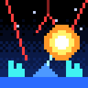
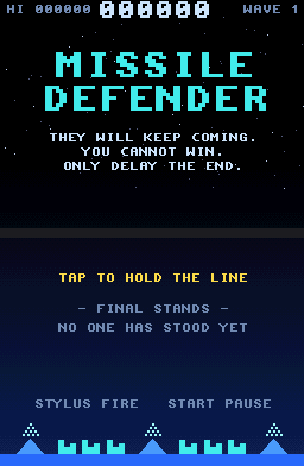
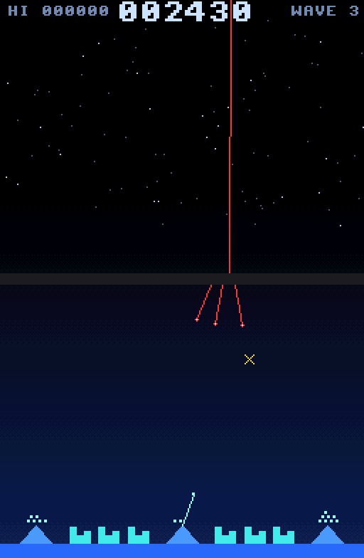
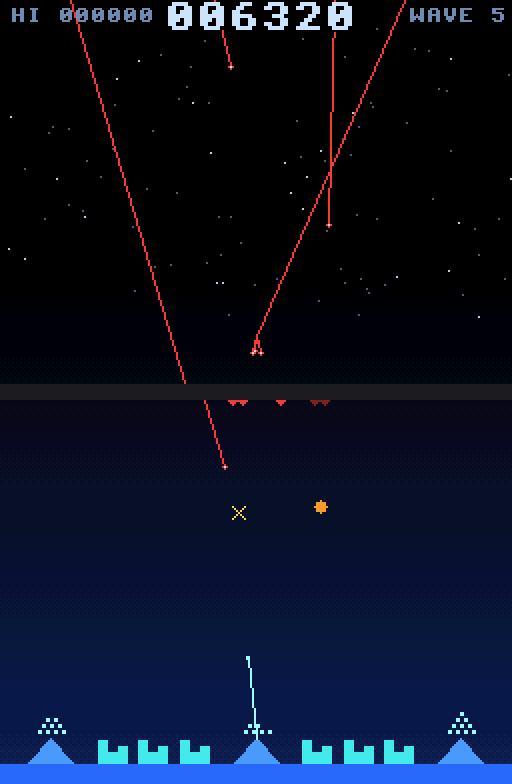
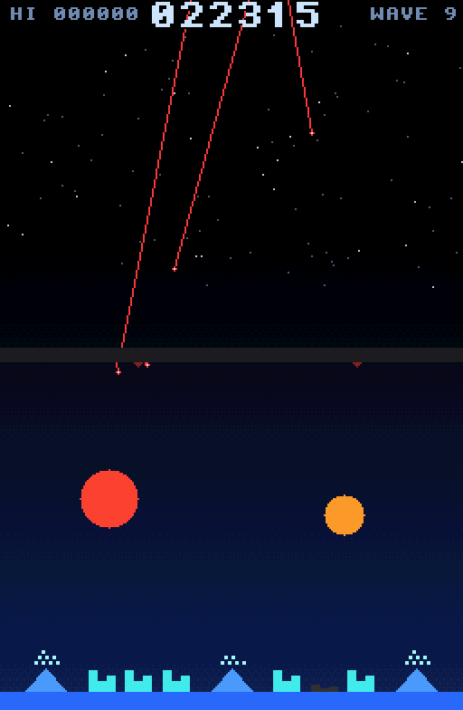
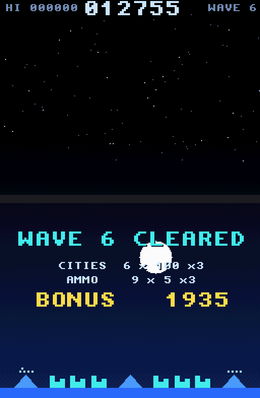
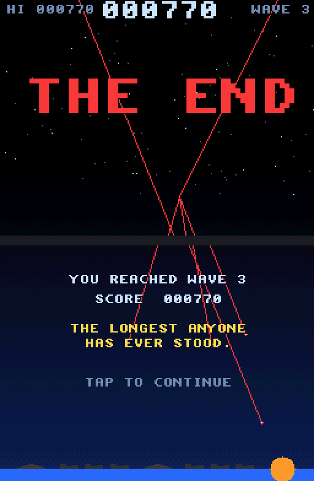

# Missile Defender DS



A two-screen arcade game for the Nintendo DS, inspired by the 1980 arcade
classic *Missile Command*. Warheads come in from space on the top screen.
You can only shoot them once they reach the lower atmosphere on the touch
screen, so you watch, plan, then tap the sky to launch counter-missiles and
protect six cities from endless waves.

This is the DS version of
[Missile Defender for iPhone](https://github.com/HenriVSL/Missile-Defender),
with the same retro vector look, rules and tuning, adapted to two screens and a stylus.

<p align="center">
  
  
  
</p>
<p align="center">
  
  
  
</p>

## Features

| | |
|---|---|
| **Two atmospheres** | The top screen is the upper atmosphere. Warheads appear there and you can only watch their trails. The bottom screen is the lower atmosphere, where you can fire |
| **Entry markers** | Small red arrows on the top edge of the touch screen show where each warhead will come through the gap between the screens. They brighten just before it arrives |
| **Tap to fire** | Tap anywhere in the lower sky. The nearest battery that still has ammo launches a counter-missile at that point |
| **Three batteries, six cities** | Batteries sit at the left, centre and right, with two groups of three cities between them. The centre battery fires faster missiles |
| **Limited ammo** | 10 missiles per battery per wave, shown as a small pyramid of dots above each battery. A battery that gets hit is out until the next wave |
| **Blasts** | Counter-missiles detonate where you tapped. The blast expands, holds and contracts, destroying every warhead it touches |
| **Endless waves** | Each wave brings more and faster missiles with shorter gaps between launches. There is no winning, only a higher score |
| **MIRVs** | From wave 3, some warheads split into two or three around the boundary between the screens, and this becomes more likely as the waves go on |
| **Scoring** | 25 points per warhead, multiplied by the wave tier (x1 for waves 1 to 2, rising to x6 from wave 11). End-of-wave bonus for unused missiles and surviving cities |
| **Bonus cities** | Batteries are rebuilt every wave, but destroyed cities stay down. Every 10,000 points earns a rebuilt city at the end of the wave |
| **High scores** | Top 5 scores are saved to the SD card and shown on the title screen |
| **Demo mode** | Leave the title screen alone for 20 seconds and an autopilot plays. Tap to take over |
| **Pause** | START pauses. Tap or press START to resume |
| **Sound** | Short PSG and noise blips for firing, hits and losing a city or battery |

The game ends when all six cities are destroyed.

## Controls

| Input | Action |
|---|---|
| Stylus tap (bottom screen) | Fire a counter-missile at that point |
| START | Pause / resume |
| Tap or A/B/X/Y | Start, continue, leave the demo |

## Install

1. Download `missiledef.nds` from the
   [latest release](https://github.com/HenriVSL/Missile-Defender-DS/releases/latest).
2. Copy it to the SD card of a DSi or 3DS running homebrew (for example
   [TWiLight Menu++](https://github.com/DS-Homebrew/TWiLightMenu)), or to a DS
   flashcart.
3. Launch it from your homebrew menu.

Tested on a **DSi XL**. High scores are written to `missiledefender.sav` next
to the ROM. If the launcher gives the game no SD access, the game still runs
but scores are not kept.

## How it works

- Everything is in [`source/main.c`](source/main.c), written in C against
  libnds 2 (calico).
- The world is one tall column: top screen, a 32-pixel invisible gap, then the
  touch screen. Warheads fly straight lines through all of it, so their trails
  line up across the two screens.
- Each screen has two 8bpp bitmap layers: a static backdrop (starfield and the
  sky turning blue toward the horizon, dithered) and a scene layer that is
  redrawn every frame in main RAM and DMA'd to VRAM during vblank.
- Positions are 24.8 fixed point, since the ARM9 has no FPU. Floats are only
  used when a missile picks a new course.
- Text uses the libnds 8x8 font, scaled and drawn straight into the bitmaps.
- Gameplay values (speeds, wave sizes, MIRV odds, blast timing, scoring) are
  `#define`s at the top of `main.c`, ported from the iOS version's `Config.swift`
  and scaled to DS pixels.
- A busy late wave uses about a quarter of each 60 Hz frame on DS hardware
  timings.

## Build from source

Requires [devkitPro](https://devkitpro.org/wiki/Getting_Started) with
devkitARM and libnds 2.x.

```sh
make
```

This produces `missiledef.nds`. You can also build with the official Docker image:

```sh
docker run --rm -u "$(id -u):$(id -g)" -v "$PWD:$PWD" -w "$PWD" devkitpro/devkitarm make
```

`smoke_test.txt` is a script for a headless melonDS test harness. It starts a
game, intercepts the first warhead, pauses, and takes screenshots. Game state
is exposed through the `g_debug` struct in `main.c`.

## Third-party components

- [libnds](https://github.com/devkitPro/libnds) (zlib license) with
  [calico](https://github.com/devkitPro/calico) and libfat (ZPL-2.1), from
  devkitPro. The 8x8 font is libnds's default console font.

*Missile Command* is a trademark of its respective owner. This project is not
affiliated with or endorsed by Atari. Nintendo DS is a trademark of Nintendo.

## License

MIT, see [LICENSE](LICENSE).
